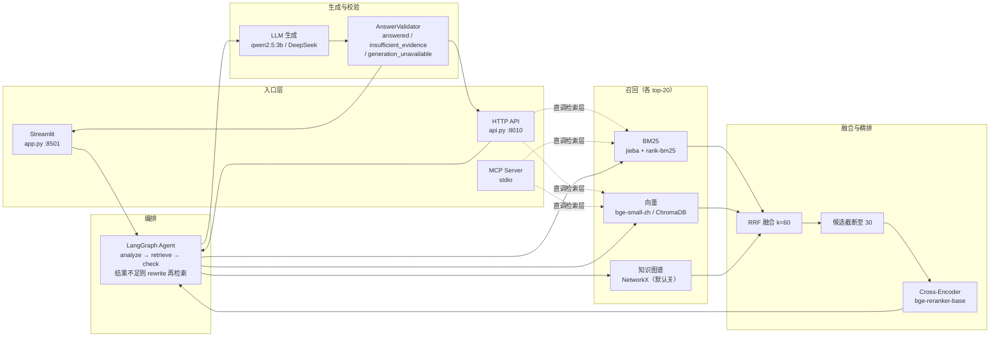
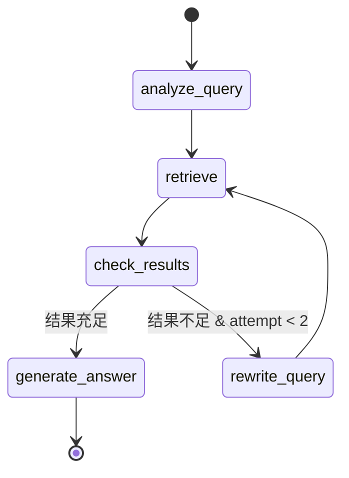

# MCP-RAG-Hub

一个可本运行的 RAG 知识库 MCP 服务：把文档喂给它，Claude 等 AI 客户端就能通过标准接口检索你的本地 PDF / Markdown / TXT / Python 文档。

<div align="center">  
    
    
  
  <em>输入一条查询，界面同时展示关键词、语义、融合、精排四个阶段的检索结果</em>  
</div>

全链路自研（非调现成 RAG 框架）：文档解析 → BM25+向量混合召回 → RRF 融合 → Cross-Encoder 精排 → LangGraph 代理编排 → FastMCP 工具封装，配**自建中文评测集：主集 375 条 + 版本混淆独立探针 31 条**（含五档基线阶梯、拒答阈值调优与失败模式标注）。

> **关于名字里的 "TiDB"**：指**语料领域**——TiDB 中文文档 1318 篇 + 版本差异页 306 + AskTUG 社区问答 5009 + 专栏 2536 = **9169 篇**，**不是本项目使用的数据库**，向量存储为 ChromaDB。该语料受 CC BY-SA 限制不入库，仓库内置的可分发语料是 `fastapi-zh` / `vue-zh`。

## 功能

- **全手工 RAG 管线** — 文档解析（PDF/Markdown/TXT/Python，按类型分块）→ BM25+向量双路召回 → RRF 融合 → Cross-Encoder 精排，全链路自研，不依赖现成 RAG 框架
- **Streamlit 交互** — 两个顶层 Tab（**问答模式 / 调试模式**）；调试模式下逐阶段展示 BM25/向量/RRF/CE 四路检索结果，输入一条查询即可看到每路召回与最终排序
- **LangGraph 代理** — 五节点状态机，条件路由，查询改写与自我纠错
- **MCP 工具** — FastMCP 封装四个工具接口，可接入 Claude Desktop 等任何 MCP 客户端
- **完整评测** — 自建中文评测集 **375 条主集 + 31 条版本混淆独立探针**：五档基线阶梯（BM25 → 向量 → RRF → CE → 拒答阈值调优）、失败模式六分类标注、版本混淆干扰率独立报告；评测脚本可断点续跑，产物落盘可复查
- **知识图谱检索**（可选实验功能，默认关闭）— LLM 三元组抽取 + 有向图构建，用 `ENABLE_KG` 开关启用

**四阶段检索界面实拍**：

|                                 BM25 关键词召回                                |                                          向量语义召回                                          |
| :-----------------------------------------------------------------------: | :--------------------------------------------------------------------------------------: |
|  |                   |
|                                 **RRF 融合**                                |                                   **Cross-Encoder 精排**                                   |
|       |  |

**三种"没有给出答案"的界面表现**（2026-09-20 实拍）—— 把**技术故障**与**业务判断**分开显示，  
避免"服务坏了"被看成"知识库没有"，把排查方向带偏：

|                              知识库里确实没有 → **拒答**                              |                               LLM 服务连不上 → **降级**（仍给证据）                              |
| :-------------------------------------------------------------------------: | :---------------------------------------------------------------------------------: |
|  |  |
|                   黄色告警 + 拒答原因，证据卡片带 `CE Score`（本例 0.0296）                   |                             红色告警 + 故障原因，**照常展示检索到的原文证据**                            |

## 架构

三个入口共用一条检索管线 —— 界面、HTTP 接口、MCP 工具都走同一份 `src/pipeline.py` 单例，不存在"某条路径另有一份实现"：



> **虚线 = 跳过 agent 编排、直调检索层**（`/search` 的 `mode` 与 MCP 的 `search_knowledge` 走这条，不经生成与校验）；**实线 = 完整链路**。
>
> 检索配置是**冻结**的（深度 20+20、候选截断至 30）：`depth50x50` 消融已证加深召回是负收益，瓶颈在 CE 判别力而不是召回量。图上的数字都是实测值，出处见 [`EVAL_REPORT.md`](EVAL_REPORT.md)。

Agent 状态机（`python agent.py --diagram` 可复现）：



## 快速开始

**前提**：Python 3.11+。知识库语料放在 `corpora/<语料名>/` 目录，首次运行会自动解析并构建索引。切换语料用环境变量 `MCP_RAG_CORPUS`（每份语料使用独立的 Chroma 集合，互不覆盖；详见 [corpora/README.md](corpora/README.md)）。

仓库内置两份**可公开分发**的语料：`corpora/fastapi-zh`（默认，FastAPI 中文文档 122 篇）与 `corpora/vue-zh`（Vue 3 中文文档，CC BY 4.0）。另有一份 **TiDB 中文语料**（官方文档 + 社区问答/专栏，约 9 千篇 / 10 万 chunk）用于规模与版本混淆评测 —— 因其授权限制（官方文档 CC BY-SA 3.0、社区内容为 UGC）**不入仓库**，可用 `scripts/fetch_tidb_corpus.py` 本地重抓，详见 `corpora/README.md`。

```bash
# 1. 创建虚拟环境（Windows）
python -m venv .venv
.venv\Scripts\activate

# 2. 安装依赖
pip install -r requirements.txt

# 3. Windows 下额外安装 PyTorch（CPU 版即可，requirements.txt 不自动带）
pip install torch --index-url https://download.pytorch.org/whl/cpu

# 4. 启动 Streamlit 网页界面，浏览器打开 http://localhost:8501
streamlit run app.py
```

> 也可跳过界面，直接作为 MCP 服务使用（见下文）。Embedding 模型首次运行会自动下载到本地缓存，之后可设 `HF_HUB_OFFLINE=1` 离线启动。
>
> 纯检索演示无需 Ollama；仅 **LangGraph 代理 / LLM 评测（LLM-as-Judge）** 需要本机安装 Ollama。  
> 模型分工：**生成用 `qwen2.5:3b`**（纯 CPU 可跑的窄任务模型）、**评测裁判用 `qwen2.5:7b`**（本机可加载的最大档）。  
> 🔴 **7b 裁判经 30 条人工盲判校准未通过（κ ≈ 0，两种提问方式均如此）** —— **裁判分数只作内部参考，不得当已校准指标引用**，证据见 [`EVAL_REPORT.md`](EVAL_REPORT.md) 第九节。  
> 7b 需约 5.6 GB 物理可用内存，本机开发环境全开时加载不了，属正常现象。

### 方式二：Docker（一条命令，不依赖本机 Python 环境）

```powershell
$env:HF_CACHE = "$env:USERPROFILE\.cache\huggingface"   # 指向宿主已缓存的模型；不设会直接报错
docker compose up --build                               # 浏览器打开 http://localhost:8501
```

模型不烧进镜像（国内直连 huggingface.co 不稳），而是挂载宿主已有缓存；Ollama 仍在宿主运行，  
容器经 `host.docker.internal` 访问。**前置条件、验证命令、已知限制**见  
[`docs/reference/Docker部署说明.md`](docs/reference/Docker部署说明.md)。

## 接入 MCP 客户端（Claude Desktop / Cursor 等）

把本服务作为知识库工具接入任何 MCP 客户端。以 Claude Desktop 为例，在 `claude_desktop_config.json` 中加：

```json
{
  "mcpServers": {
    "rag-knowledge": {
      "command": "python",
      "args": ["D:/path/to/mcp-rag-hub/src/mcp_server.py"]
    }
  }
}
```

启动后暴露四个工具：

| 工具                 | 用途                          |
| ------------------ | --------------------------- |
| `search_knowledge` | 混合检索（BM25+向量→RRF→CE）并返回精排结果 |
| `list_documents`   | 查看当前知识库已索引的文档               |
| `get_chunk`        | 按编号获取指定切片的完整内容              |
| `get_chunk_count`  | 查看知识库切片总数                   |

## HTTP API（服务层）

除了界面和 MCP，还提供一个标准 HTTP 接口 —— 第三方前端可直接接入，`/openapi.json` 就是机器可读的接口契约。

```bash
uvicorn api:app --host 127.0.0.1 --port 8010    # 或 python api.py
# Swagger UI: http://127.0.0.1:8010/docs
```

| 端点 | 说明 |
|---|---|
| `GET /health` | 健康检查。**不构建管线、不加载模型**，只读配置 + 索引集合的 `count()`（冷启动不会被拖到 2 分钟） |
| `POST /query` | 完整 agent 链路（检索 → 质量判断 → 必要时改写 → 生成 → 校验），返回三态 `answered / insufficient_evidence / generation_unavailable` + 检索证据 + 改写历史 |
| `POST /search` | 只走检索层，`mode` 可选 `bm25 / vector / rrf / ce`，默认 `rrf` |
| `GET /documents` | 语料清单。**默认按来源目录聚合**，文件清单分页（单页上限 200） |

```bash
curl -s localhost:8010/health
curl -s -X POST localhost:8010/search -H "Content-Type: application/json" \
     -d '{"query":"如何减少 TiDB 的写入热点","mode":"rrf","top_k":5}'
```

> ⚠️ **三条使用约束**
> 1. **`mode=ce` 会懒加载 bge-reranker-base（约 1.1 GB，首次 30~60 秒）**，内存 < 4 GB 的机器不要用；默认档 `rrf` 不加载 reranker。
> 2. **默认端口用 8010 而不是 8000**：8000 常被本机其它服务占用（本项目开发机上就有另一个项目在用），bind 失败会让人误以为是代码问题。
> 3. **`/health` 刻意不做完整自检**：它不建索引、不加载 embedding，所以 `status=ok` 只代表「索引集合可读」，不代表生成链路可用（后者取决于 Ollama / DeepSeek 是否就绪，见 `/health` 的 `llm_backend`）。
> 4. **服务层不做容器化**：镜像只含 Streamlit（`Dockerfile` 的 CMD 是单进程），`docker compose up` 只暴露 `8501`。API 请在本机 venv 里跑 —— 为了一个 4 端点的接口再引入 supervisor / 双进程编排，收益不抵复杂度。
>
> 本服务不产生新的评测数字；所有指标口径以 [`EVAL_REPORT.md`](EVAL_REPORT.md) 为准（生成层三维是裁判自评、未经人工校准，仅作内部参考）。

## 项目结构

<details>

<summary>点开看完整目录树（含各模块职责）</summary>

```
mcp-rag-hub/
├── app.py                     # Streamlit 前端入口
├── agent.py                   # LangGraph Agent 入口
├── config.py                  # 全局配置中心
├── requirements.txt
│
├── src/
│   ├── models.py              # Chunk / RetrievalResult 数据结构
│   ├── data_pipeline.py       # 文档加载 + 按文件类型路由分块（Markdown 标题滑窗 / Python AST / 通用滑窗）
│   ├── retrievers.py          # BM25 + 向量双路召回
│   ├── graph_retriever.py     # 实体共现图检索（可选实验功能）
│   ├── kg_retriever.py        # LLM 三元组知识图谱检索（可选实验功能）
│   ├── kg_builder.py          # DeepSeek LLM 抽取三元组、构建知识图谱缓存
│   ├── fusion.py              # RRF 融合 + Cross-Encoder 重排序
│   ├── mcp_server.py          # FastMCP 工具封装
│   └── evaluation/            # 评测子包
│       ├── metrics.py         # 共享评测指标
│       ├── retrieval_eval.py  # 检索质量评测
│       ├── llm_eval.py        # LLM-as-Judge 生成评测
│       ├── agent_eval.py      # Agent 改写评测
│       └── experiments.py     # 消融实验与数据分析
│
├── corpora/                   # 知识库语料（每份语料一个子目录，见 corpora/README.md）
│   ├── fastapi-zh/            # 默认语料：FastAPI 中文文档 122 篇 / 1445 chunk
│   └── vue-zh/                # Vue 3 中文文档 110 篇 / 1804 chunk（CC BY 4.0）
│                              #   （tidb/ 授权受限，本地保留不入仓库，见 corpora/README.md）
│
├── data/
│   ├── eval_set.jsonl             # 主评测集 375 条（AskTUG 148 / 文档事实 167 / 不可答 40 / 误杀探针 20）
│   ├── eval_set_version.jsonl     # 版本混淆独立探针 31 条（独立集，不与主集 Hit@5 混报）
│   ├── eval_set_FROZEN.json       # 评测集冻结清单（当前 v0.1，含标注修正记录）
│   ├── failure_mode_spec.md       # 失败模式六分类定义与确定性回填规则
│   ├── judge_gold_100.jsonl       # LLM 裁判金标 100 条（生成层评测校准用）
│   ├── test_queries.json          # 早期小验收集 18 条（绑定 fastapi-zh，现作功能演示）
│   ├── unanswerable_queries.json  # 早期拒答小集 10 条
│   ├── multi_evidence_queries.json# 早期多证据小集 3 条
│   └── knowledge_triples.jsonl    # KG 三元组缓存（可选实验功能 ENABLE_KG）
│
├── docs/                      # 项目文档（人读，不参与索引）
│   ├── 项目详解.md / 技术视角详解.md / 开发过程中遇到的问题.md
│   ├── chapters/              #   ch01～ch10 逐层实现笔记
│   └── reference/             #   外围知识参考（RAG核心概念 / Embedding选型指南 /
│                              #     切片策略 / AST分块方案 / Docker部署说明）
├── journal/                   # 过程笔记（踩坑日志 / 实验记录 / 进度清单，强时间序）
├── Dockerfile                 # 单容器镜像（CPU 版 torch + 构建期从 ModelScope 烧入模型）
├── docker-compose.yml         # 一条命令拉起，含卷挂载与健康检查
├── experiments/               # 实验结果 JSON + 评测隔离向量库
└── chroma_db/                 # ChromaDB 持久化向量库（主）
```

</details>

## 评测集设计

> 这一章讲「评测集为什么长这样」。数字结果在下一节；本章只交代设计决策与判定规则，因为前者可以被抄，后者才是方法。

### 为什么拆成 375 + 31，而不是一个大集

两类问题被分开测，因为它们的**判定规则和失败含义都不同**：

- **主集 375 条**判「能不能答对」，命中判定是 **slug 级** —— golden 页面的任何版本命中都算命中。
- **独立探针 31 条**判「版本对不对」，判定看 **`metadata.source` 的目录前缀**（`docs-cn/` 还是 `docs-cn-v8.4/`）。

如果合并成一个集，Hit@5 就变成了两个概念的加权混合：既分不清"没找到"和"找到旧版本"，也让版本混淆的收益（CE 在版本口径上的真实价值）被埋掉。

主集构成：

| 来源 | 条数 | 用途 |
|---|---|---|
| 文档事实类（`doc_fact`） | 167 | golden 直指官方文档页，测事实检索 |
| 社区提问类（`asktug`） | 148 | 真实用户口语提问，测术语鸿沟 |
| 不可答（`unanswerable`） | 40 | 知识库里确实没有 → 测「该不该说不知道」 |
| 误杀探针（`miss_kill`） | 20 | 可答但问法刁钻 → 测「会不会乱拒」 |

🔴 **Hit@5 的分母是 335，不是 375** —— 40 条不可答没有 golden，不进检索分母。任何 Hit@5 都必须写成 `x/335`，写成 `/375` 即口径错误。

### 六类失败模式（互斥、可复算）

| 编号 | 名称 | 层 | 判据 |
|---|---|---|---|
| F1 | 召回缺失 | 检索 | golden slug 既不在 BM25 top-50、也不在向量 top-50 |
| F2 | 排序压制 | 检索 | golden 进了候选池，但 RRF top-5 里没有 |
| F3 | 术语鸿沟 | 检索（根因） | query 用口语/告警术语，页面用规范术语；**人工抽检判定，不自动判** |
| F4 | 应拒答未拒答 | 拒答 | `unanswerable=true` 却正常作答 |
| F5 | 拒答误杀 | 拒答 | 可答样本被拒 |
| F6 | 版本混淆 | 检索（独立集） | 命中错误版本页而非正确版本页 |

三条容易踩的规则，写在这里避免误读：

1. **F3 只作 `root_cause`，不作 `primary`** —— 它是抽检得出的根因标签（50 条、`seed=42`），不是全量逐条判定。
2. **F6 不在主集里** —— 主集里出现版本孪生命中仍按主集口径算命中，只作诊断项单列。
3. **`none` ≠ 空值** —— `none` = 已标注且无失败；空 = 未标注。两者混用会污染分布统计。跑不出的极端情况单列 `unclassified`，**不硬塞进五类**。

定义与回填规则完整版：[`data/failure_mode_spec.md`](data/failure_mode_spec.md)。

### 困难负例 40 条是怎么来的

不是"造"出来的，是**从真实社区提问里挑「知识库确实没有」的**：

- 来源是 AskTUG 上真实存在、但答案不在本语料范围内的问题（版本差异、第三方集成、运维环境相关）。
- 负例**不由模型生成**。模型生成的负例测的是模型自己的想象力边界，不是知识库的真实盲区。
- 它们是"不可答"样本，跑基线后自然产生「该拒未拒」的失败 —— 所以负例清单不需要单独维护，**是基线跑出来的副产品**。

### 为什么冻结，以及 CI 为什么绑 sha256

**冻结**（`data/eval_set_FROZEN.json`，v0.1）：评测集一改，之前所有数字全部失效。冻结清单记录版本、冻结时间、被谁取代、以及哪些条目被延后处理（`deferred`）—— 这份文件让"数字是哪一版评测集跑出来的"可追溯。

**CI 绑 sha256**（`tests/regression_baselines.json`）：只冻结评测集不够，产物也会被重跑覆盖。所以回放层把 6 条冻结基线**和产物文件的 sha256 一起绑死**——产物被覆盖就会先红，报错直接给出复算到的新值，逼着显式改基线，而不是让数字悄悄漂移。

这就是"防假绿"的具体形态：**不是靠人记得核对，是靠不一致时 CI 必然失败**。

### 引用纪律（读下一节前的三条红线）

1. **Hit@5 一律 `/335`**；主集 375 与独立探针 31 的数字**不进同一句话**。
2. **拒答有两套口径**：CE 阈值模拟值（`[A]`/`[B]`）与真实 agent 链路实测值，**不得混报、不得拼成「A% → B%」的改进叙事**。
3. **延迟数字必须带样本量**（`n=48` 与 `n=18` 是两批，不跨批比较）。

## 关键数据

> 当前实测基于 **TiDB 中文语料**（约 9 千篇 / **104,192 chunk**），评测集为自建 **375 条主集 + 31 条版本混淆独立探针**（冻结版 v0.1）。  
> 完整报告见 [`EVAL_REPORT.md`](EVAL_REPORT.md)；过程笔记见 [基线阶梯](journal/基线阶梯-2026-10-14.md) 与 [版本混淆评测](journal/版本混淆评测-2026-10-14.md)。

### 检索侧：五档基线阶梯（335 条有 golden 样本口径）

| 档                         | Hit@5      | Hit@20 | Hit@50 | MRR@10 |
| ------------------------- | ---------- | ------ | ------ | ------ |
| 1. BM25 单路（无优化基线 **[X]**） | **0.3045** | 0.4657 | 0.5582 | 0.1849 |
| 2. 向量单路                   | 0.2627     | 0.4478 | 0.5493 | 0.1615 |
| 3. RRF 融合（**[Y]**）        | **0.3254** | 0.4896 | 0.5433 | 0.2078 |
| 4. CE 精排（200 条子集）         | 0.3100     | —      | —      | 0.1770 |

**怎么读：**

- **融合有效但幅度有限**：BM25 → RRF **+2.1 个百分点**，且逐条并非单调改善（存在单路命中、融合后被挤出 top-5 的样本）
- **本语料上稠密检索弱于稀疏检索**（0.2627 < 0.3045）——排障类中文 query 携带大量字面专有名词（参数名、告警名、报错原文），BM25 的字面匹配更吃得准
- **CE 在 slug 级指标上零增益**：同一 200 条子集上 RRF 与 CE 同为 0.31（**+18 新增 / −18 丢失，净 0**）。理论上限是 RRF 候选池 recall@30 = **0.535** → **瓶颈在 CE 判别力，不在候选数量**
- **但 CE 在"版本正确性"口径上有真实价值**：独立探针上把「旧版页压过正确版页」从 **19.4% 压到 9.7%**（约砍半）——这条收益在 slug 级指标下会被完全掩盖

### 拒答能力：阈值调优

| 阈值               | 拒答误杀率          | 正确拒答率           | 净命中        |
| ---------------- | -------------- | --------------- | ---------- |
| **[A] 0.3（默认）**  | 0.0（0/20）      | **0.025（1/40）** | 62/200     |
| 0.95             | 0.0            | 0.15（6/40）      | 62/200     |
| **[B] 0.98（膝点）** | **0.05（1/20）** | **0.25（10/40）** | 62/200（不降） |
| 0.99             | 0.05           | 0.35（14/40）     | 60/200     |

> **默认阈值下的"零误杀"其实是"从不拒答"的副作用**——正确拒答率只有 2.5%，拒答机制形同虚设。  
> 根因是 CE top-1 分数严重饱和（可答样本 **97.5% ≥ 0.99**），任务书指定的 0.3~0.7 区间**完全落在饱和区、无操作空间**。  
> 结论：**CE 绝对分数不能做拒答门控**，拒答应交给 LLM / validator 判定。

### 版本混淆独立评测（[Z]）

| 档         | [Z] 干扰率（全量 31） | [Z]\_high（高差异 28） | 危害（旧版压过正确版） |
| --------- | -------------- | ----------------- | ----------- |
| BM25      | 0.3226         | 0.2857            | 0.1935      |
| 向量        | 0.2581         | 0.1786            | 0.1290      |
| RRF（生产配置） | **0.2581**     | 0.2500            | 0.1935      |
| CE        | 0.2581         | 0.2143            | **0.0968**  |

> [Z] = top-5 内出现旧版本差异页（`docs-cn-v8.4/`）的探针占比。**独立集、不同口径，不得与主集 Hit@5 混成同一个数字讲。**

### 失败模式分布（主集 375）

召回缺失 **114** / 排序压制 **112** / none **118** / 应拒答未拒答 **30** / 拒答误杀 **1**。  
术语鸿沟抽检 50 条：**54%** 存在，但按来源极不均匀 —— AskTUG **80%**、文档事实 **11%**（后者 query 本就照页面写）。定义见 [`data/failure_mode_spec.md`](data/failure_mode_spec.md)；**逐条案例见 [`data/failure_cases.md`](data/failure_cases.md)**（确定性复算生成，CI 校验文档与复算一致）。

### 延迟画像（CE 是绝对瓶颈）

10 万级 chunk 索引、纯 CPU、空载实测（**n=48** = 50 条 − 2 条 warmup）：三路检索合计**不到 1 秒**（BM25 均 609 ms / 向量 45~63 ms / RRF 0.2 ms），**Cross-Encoder 精排占端到端 90.1%** —— 瓶颈唯一在 CE。

候选截断至 30（对照臂 K=50）同批实测：Pipeline **P50 6514 ms / P95 8975 ms / mean 6628 ms**；对照臂 **P95 11085 ms** → **P95 −2109.8 ms（−19.0%）**、P50 −16.6%、mean −18.1%，CE 自身 mean 7417 → 5973（−19.5%）。精度侧**未观察到显著损失**：同批离线截断、335 分母，**Hit@5 0.3134（105/335）→ 0.3284（110/335），+1.5pt**（配对检验 p=0.267，不显著，见 `EVAL_REPORT.md` 第十一节）。

> ⚠️ **引用必须连样本量一起写**；P95 在 n ≤ 20 时退化成 max，故 P50/P95 需 **n ≥ 40**。
>
> 📜 **历史语料对照（fastapi-zh，1445 chunk，❌ 不可与上文比）**：四项检索合计 56 ms、CE 占 99.8%，单条全链路 12.8 s，2026-09-18 起候选截断后为 7.30 s。chunk 量差约 70 倍，绝对值不可比，唯一可迁移的是结构性结论「CE 是绝对瓶颈」。更早一批 TiDB 实测（**n=18**）为 7647 ms / CE 91.4%，跨批低约 13%，**同样不与 n=48 混批比**。现行口径见 [`EVAL_REPORT.md`](EVAL_REPORT.md) 第九节。

### 生成侧：已实测

生成层三维指标（Faithfulness / Answer Relevancy / Context Recall）**已在 TiDB 语料上重测**（2026-10-15，100 条 Judge 金标，7B 裁判 / 3B 生成）：**0.785 / 0.761 / 0.568**。🔴 **但打分裁判未经人工校准**（30 条盲判 κ ≈ 0，见「环境准备」的模型分工说明）→ **这三个数只作内部参考，不得当已校准指标对外引用**；客观计数部分不受影响（生成 100 条失败 0 / 空答 0）。端到端拒答（真实 agent 链路）**正确拒答仅 10.5%（4/38）**、`miss_kill` 误杀 **5%（1/20）** —— 拒答能力弱是已知短板。**旧 fastapi-zh 的生成层数字一律仍不可引用**；详见 [`EVAL_REPORT.md`](EVAL_REPORT.md) 第八、九节。

### 评测脚本用法

```bash
# 用 --tag 跑实验（产物落到 experiments/runs/<tag>/，不覆盖冻结的 baseline_ladder/）
python -m scripts.eval_baseline_ladder --tag k25test --stage retrieval

# 对比两份评测产物（防退化门禁）：Hit@5 分子/分母 + 丢失/新增命中 id + REGRESSION/OK 判定
python -m scripts.diff_eval_run experiments/baseline_ladder/retrieval_375.jsonl experiments/runs/k25test/retrieval_375.jsonl --stage rrf
```

**知识图谱检索（可选实验）**：用 LLM 抽取实体三元组、构建有向知识图谱，作为混合检索的一路补充。`ENABLE_KG` 开关控制。当前在**小规模、同主题语料**上未带来检索提升（独立评估见 [KG 消融实验笔记](journal/KG消融实验-2026-08-04.md)），因此默认关闭——它展示的是「多路召回设计」的扩展能力，而非当前主推的检索路线。

## 技术栈

| 层次            | 技术                                                                 |
| ------------- | ------------------------------------------------------------------ |
| 语言            | Python 3.11+                                                       |
| Embedding     | BAAI/bge-small-zh-v1.5（512 维，中文优化）                                 |
| Cross-Encoder | BAAI/bge-reranker-base（中文优化）                                       |
| 向量库           | ChromaDB（HNSW 索引, L2 距离）                                       |
| 关键词检索         | rank-bm25 + jieba 分词                                               |
| 图检索           | NetworkX 实体共现图 + 子图遍历                                              |
| 融合            | RRF（Reciprocal Rank Fusion, k=60）                                  |
| 代理            | LangGraph（声明式状态机, 条件路由）                                            |
| LLM（生成）       | Ollama + qwen2.5:3b（纯 CPU 推理；7b 在本机开发环境会 OOM）                      |
| LLM（裁判）       | Ollama + qwen2.5:7b（`JUDGE_MODEL`，仅跑评测时加载）                         |
| 评测            | 自实现 LLM-as-Judge（Faithfulness / Answer Relevancy / Context Recall） |
| MCP           | FastMCP 2.0（stdio 传输）                                              |
| UI            | Streamlit                                                          |

## 深入文档

[`docs/`](docs/README.md) 下有 [项目详解](docs/项目详解.md)（面向非技术读者）·  
[技术视角详解](docs/技术视角详解.md)（架构与关键数据）·  
[chapters/](docs/chapters/)（ch01～ch10 逐层实现笔记，含每一步的取舍与被数据推翻的结论）。

[`blog/`](blog/) 放对外长文：

- [《我把 LLM-as-Judge 校准到失败》](blog/2026-10-17-judge-calibration-failure.md) —— 30 条人工盲判、两版裁判 prompt、一条替代路线全部失败的过程记录，以及为什么最后选择「不报这个数字」。
- [《把「慢」拆到毫秒》](blog/2026-10-18-latency-profile-and-bottleneck.md) —— 分阶段延迟画像、用对照臂拿到 −19.0% 的取舍过程、以及「到哪里该停手」的上限判断（CE 候选池 192/335、池内保真率 59.9%、±2pt 在这个样本量上不可检）。
