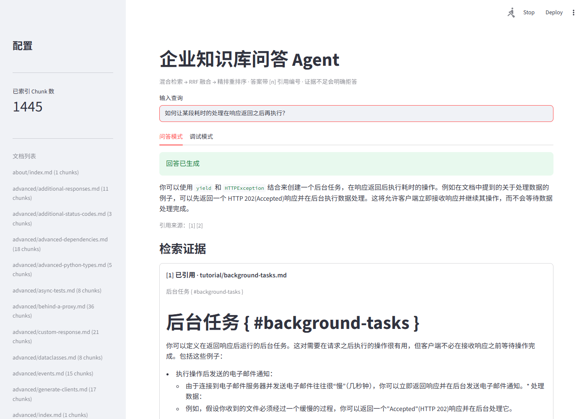
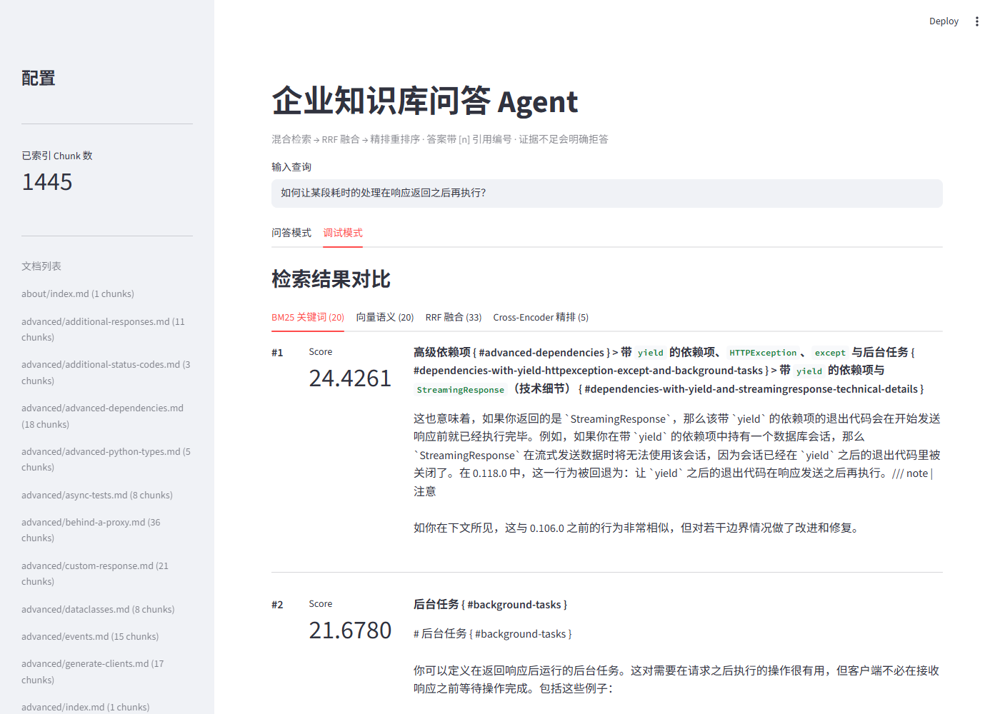
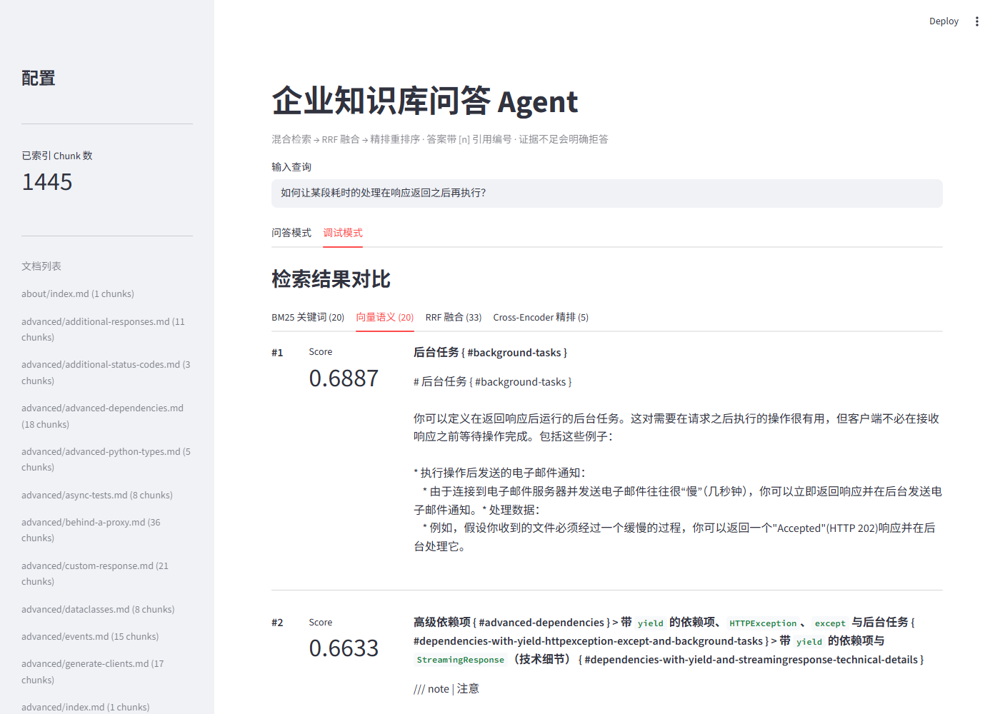
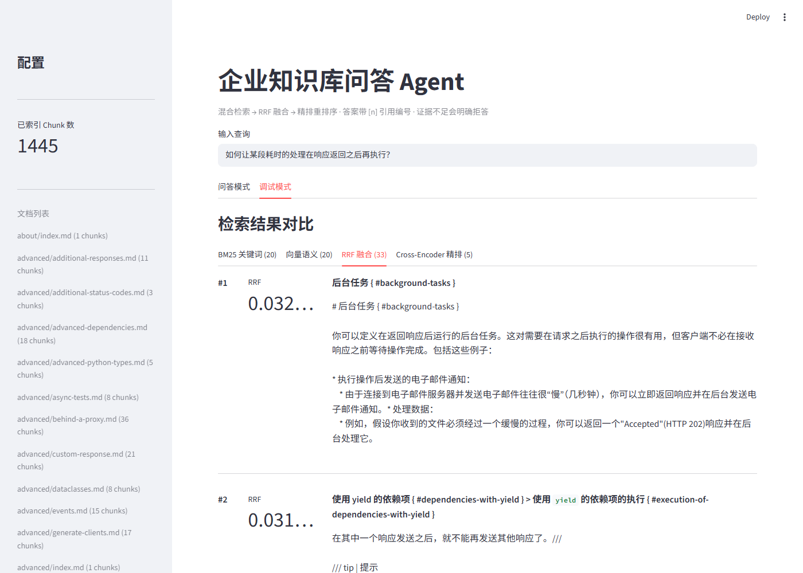
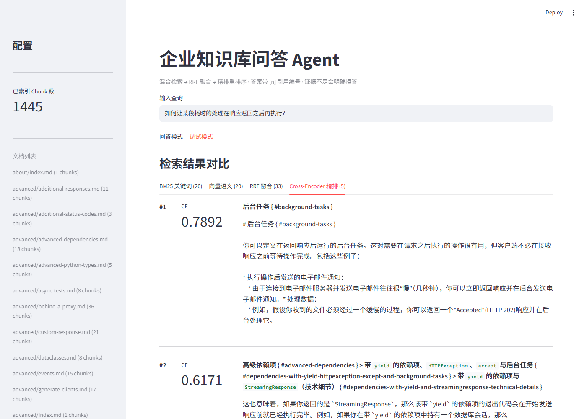
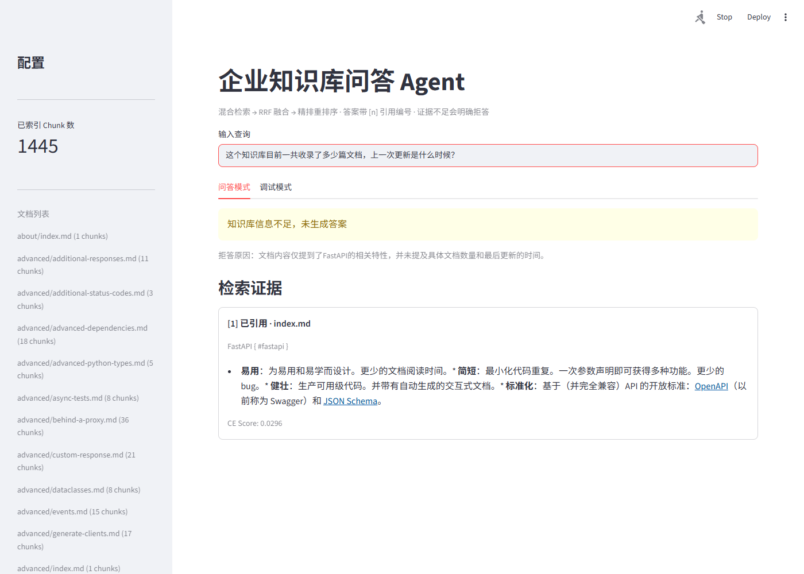
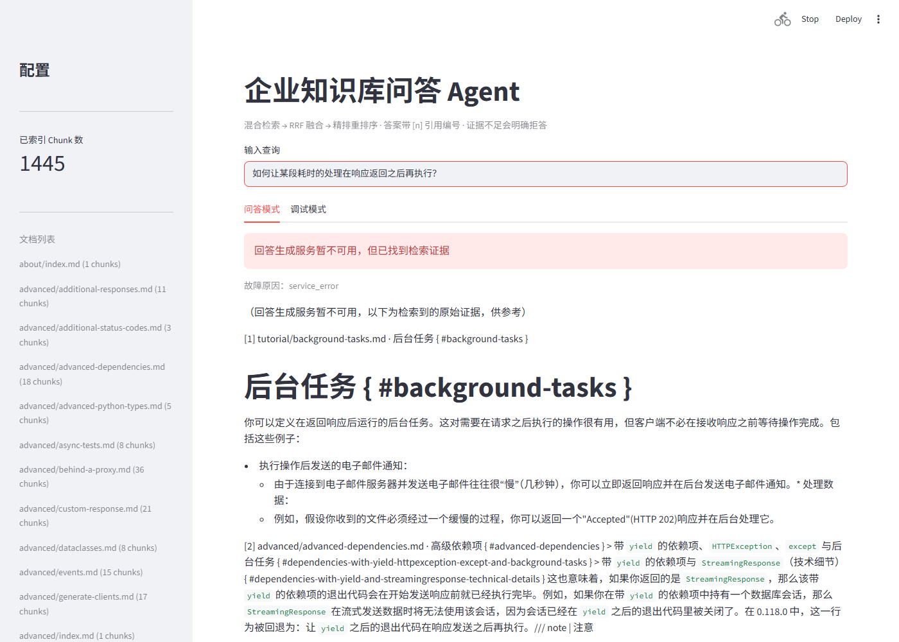

# MCP-RAG-Hub

一个可本运行的 RAG 知识库 MCP 服务：把文档喂给它，Claude 等 AI 客户端就能通过标准接口检索你的本地 PDF / Markdown / TXT / Python 文档。

<div align="center">  
    
    
  
  <em>输入一条查询，界面同时展示关键词、语义、融合、精排四个阶段的检索结果</em>  
</div>

全链路自研（非调现成 RAG 框架）：文档解析 → BM25+向量混合召回 → RRF 融合 → Cross-Encoder 精排 → LangGraph 代理编排 → FastMCP 工具封装，配**自建中文评测集：主集 375 条 + 版本混淆独立探针 31 条**（含五档基线阶梯、拒答阈值调优与失败模式标注）。

## 功能

- **全手工 RAG 管线** — 文档解析（PDF/Markdown/TXT/Python，按类型分块）→ BM25+向量双路召回 → RRF 融合 → Cross-Encoder 精排，全链路自研，不依赖现成 RAG 框架
- **Streamlit 交互** — 两个顶层 Tab（**问答模式 / 调试模式**）；调试模式下逐阶段展示 BM25/向量/RRF/CE 四路检索结果，输入一条查询即可看到每路召回与最终排序
- **LangGraph 代理** — 五节点状态机，条件路由，查询改写与自我纠错
- **MCP 工具** — FastMCP 封装四个工具接口，可接入 Claude Desktop 等任何 MCP 客户端
- **完整评测** — 自建中文评测集 **375 条主集 + 31 条版本混淆独立探针**：五档基线阶梯（BM25 → 向量 → RRF → CE → 拒答阈值调优）、失败模式六分类标注、版本混淆干扰率独立报告；评测脚本可断点续跑，产物落盘可复查
- **知识图谱检索**（可选实验功能，默认关闭）— LLM 三元组抽取 + 有向图构建，用 `ENABLE_KG` 开关启用

**四阶段检索界面实拍**：

|                                 BM25 关键词召回                                |                                          向量语义召回                                          |
| :-----------------------------------------------------------------------: | :--------------------------------------------------------------------------------------: |
|  |                   |
|                                 **RRF 融合**                                |                                   **Cross-Encoder 精排**                                   |
|       |  |

**三种"没有给出答案"的界面表现**（2026-09-20 实拍）—— 把**技术故障**与**业务判断**分开显示，  
避免"服务坏了"被看成"知识库没有"，把排查方向带偏：

|                              知识库里确实没有 → **拒答**                              |                               LLM 服务连不上 → **降级**（仍给证据）                              |
| :-------------------------------------------------------------------------: | :---------------------------------------------------------------------------------: |
|  |  |
|                   黄色告警 + 拒答原因，证据卡片带 `CE Score`（本例 0.0296）                   |                             红色告警 + 故障原因，**照常展示检索到的原文证据**                            |

## 快速开始

**前提**：Python 3.11+。知识库语料放在 `corpora/<语料名>/` 目录，首次运行会自动解析并构建索引。切换语料用环境变量 `MCP_RAG_CORPUS`（每份语料使用独立的 Chroma 集合，互不覆盖；详见 [corpora/README.md](corpora/README.md)）。

仓库内置两份**可公开分发**的语料：`corpora/fastapi-zh`（默认，FastAPI 中文文档 122 篇）与 `corpora/vue-zh`（Vue 3 中文文档，CC BY 4.0）。另有一份 **TiDB 中文语料**（官方文档 + 社区问答/专栏，约 9 千篇 / 10 万 chunk）用于规模与版本混淆评测 —— 因其授权限制（官方文档 CC BY-SA 3.0、社区内容为 UGC）**不入仓库**，可用 `scripts/fetch_tidb_corpus.py` 本地重抓，详见 `corpora/README.md`。

```bash
# 1. 创建虚拟环境（Windows）
python -m venv .venv
.venv\Scripts\activate

# 2. 安装依赖
pip install -r requirements.txt

# 3. Windows 下额外安装 PyTorch（CPU 版即可，requirements.txt 不自动带）
pip install torch --index-url https://download.pytorch.org/whl/cpu

# 4. 启动 Streamlit 网页界面，浏览器打开 http://localhost:8501
streamlit run app.py
```

> 也可跳过界面，直接作为 MCP 服务使用（见下文）。Embedding 模型首次运行会自动下载到本地缓存，之后可设 `HF_HUB_OFFLINE=1` 离线启动。
>
> 纯检索演示无需 Ollama；仅 **LangGraph 代理 / LLM 评测（LLM-as-Judge）** 需要本机安装 Ollama。  
> 模型分工：**生成用 `qwen2.5:3b`**（纯 CPU 可跑的窄任务模型）、**评测裁判用 `qwen2.5:7b`**（3b 当裁判无区分度）。  
> 7b 需约 5.6 GB 物理可用内存，本机开发环境全开时加载不了，属正常现象。

### 方式二：Docker（一条命令，不依赖本机 Python 环境）

```powershell
$env:HF_CACHE = "$env:USERPROFILE\.cache\huggingface"   # 指向宿主已缓存的模型；不设会直接报错
docker compose up --build                               # 浏览器打开 http://localhost:8501
```

模型不烧进镜像（国内直连 huggingface.co 不稳），而是挂载宿主已有缓存；Ollama 仍在宿主运行，  
容器经 `host.docker.internal` 访问。**前置条件、验证命令、已知限制**见  
[`docs/reference/Docker部署说明.md`](docs/reference/Docker部署说明.md)。

## 接入 MCP 客户端（Claude Desktop / Cursor 等）

把本服务作为知识库工具接入任何 MCP 客户端。以 Claude Desktop 为例，在 `claude_desktop_config.json` 中加：

```json
{
  "mcpServers": {
    "rag-knowledge": {
      "command": "python",
      "args": ["D:/path/to/mcp-rag-hub/src/mcp_server.py"]
    }
  }
}
```

启动后暴露四个工具：

| 工具                 | 用途                          |
| ------------------ | --------------------------- |
| `search_knowledge` | 混合检索（BM25+向量→RRF→CE）并返回精排结果 |
| `list_documents`   | 查看当前知识库已索引的文档               |
| `get_chunk`        | 按编号获取指定切片的完整内容              |
| `get_chunk_count`  | 查看知识库切片总数                   |

## 项目结构

<details>

<summary>点开看完整目录树（含各模块职责）</summary>

```
mcp-rag-hub/
├── app.py                     # Streamlit 前端入口
├── agent.py                   # LangGraph Agent 入口
├── config.py                  # 全局配置中心
├── requirements.txt
│
├── src/
│   ├── models.py              # Chunk / RetrievalResult 数据结构
│   ├── data_pipeline.py       # 文档加载 + 按文件类型路由分块（Markdown 标题滑窗 / Python AST / 通用滑窗）
│   ├── retrievers.py          # BM25 + 向量双路召回
│   ├── graph_retriever.py     # 实体共现图检索（可选实验功能）
│   ├── kg_retriever.py        # LLM 三元组知识图谱检索（可选实验功能）
│   ├── kg_builder.py          # DeepSeek LLM 抽取三元组、构建知识图谱缓存
│   ├── fusion.py              # RRF 融合 + Cross-Encoder 重排序
│   ├── mcp_server.py          # FastMCP 工具封装
│   └── evaluation/            # 评测子包
│       ├── metrics.py         # 共享评测指标
│       ├── retrieval_eval.py  # 检索质量评测
│       ├── llm_eval.py        # LLM-as-Judge 生成评测
│       ├── agent_eval.py      # Agent 改写评测
│       └── experiments.py     # 消融实验与数据分析
│
├── corpora/                   # 知识库语料（每份语料一个子目录，见 corpora/README.md）
│   ├── fastapi-zh/            # 默认语料：FastAPI 中文文档 122 篇 / 1445 chunk
│   └── vue-zh/                # Vue 3 中文文档 110 篇 / 1804 chunk（CC BY 4.0）
│                              #   （tidb/ 授权受限，本地保留不入仓库，见 corpora/README.md）
│
├── data/
│   ├── eval_set.jsonl             # 主评测集 375 条（AskTUG 148 / 文档事实 167 / 不可答 40 / 误杀探针 20）
│   ├── eval_set_version.jsonl     # 版本混淆独立探针 31 条（独立集，不与主集 Hit@5 混报）
│   ├── eval_set_FROZEN.json       # 评测集冻结清单（当前 v0.1，含标注修正记录）
│   ├── failure_mode_spec.md       # 失败模式六分类定义与确定性回填规则
│   ├── judge_gold_100.jsonl       # LLM 裁判金标 100 条（生成层评测校准用）
│   ├── test_queries.json          # 早期小验收集 18 条（绑定 fastapi-zh，现作功能演示）
│   ├── unanswerable_queries.json  # 早期拒答小集 10 条
│   ├── multi_evidence_queries.json# 早期多证据小集 3 条
│   └── knowledge_triples.jsonl    # KG 三元组缓存（可选实验功能 ENABLE_KG）
│
├── docs/                      # 项目文档（人读，不参与索引）
│   ├── 项目详解.md / 技术视角详解.md / 开发过程中遇到的问题.md
│   ├── chapters/              #   ch01～ch10 逐层实现笔记
│   └── reference/             #   外围知识参考（RAG核心概念 / Embedding选型指南 /
│                              #     切片策略 / AST分块方案 / Docker部署说明）
├── journal/                   # 过程笔记（踩坑日志 / 实验记录 / 进度清单，强时间序）
├── Dockerfile                 # 单容器镜像（CPU 版 torch + 构建期从 ModelScope 烧入模型）
├── docker-compose.yml         # 一条命令拉起，含卷挂载与健康检查
├── experiments/               # 实验结果 JSON + 评测隔离向量库
└── chroma_db/                 # ChromaDB 持久化向量库（主）
```

</details>

## 关键数据

> 当前实测基于 **TiDB 中文语料**（约 9 千篇 / **104,192 chunk**），评测集为自建 **375 条主集 + 31 条版本混淆独立探针**（冻结版 v0.1）。  
> 完整报告见 [`EVAL_REPORT.md`](EVAL_REPORT.md)；过程笔记见 [基线阶梯](journal/基线阶梯-2026-10-14.md) 与 [版本混淆评测](journal/版本混淆评测-2026-10-14.md)。

### 检索侧：五档基线阶梯（335 条有 golden 样本口径）

| 档                         | Hit@5      | Hit@20 | Hit@50 | MRR@10 |
| ------------------------- | ---------- | ------ | ------ | ------ |
| 1. BM25 单路（无优化基线 **[X]**） | **0.3045** | 0.4657 | 0.5582 | 0.1849 |
| 2. 向量单路                   | 0.2627     | 0.4478 | 0.5493 | 0.1615 |
| 3. RRF 融合（**[Y]**）        | **0.3254** | 0.4896 | 0.5433 | 0.2078 |
| 4. CE 精排（200 条子集）         | 0.3100     | —      | —      | 0.1770 |

**怎么读：**

- **融合有效但幅度有限**：BM25 → RRF **+2.1 个百分点**，且逐条并非单调改善（存在单路命中、融合后被挤出 top-5 的样本）
- **本语料上稠密检索弱于稀疏检索**（0.2627 < 0.3045）——排障类中文 query 携带大量字面专有名词（参数名、告警名、报错原文），BM25 的字面匹配更吃得准
- **CE 在 slug 级指标上零增益**：同一 200 条子集上 RRF 与 CE 同为 0.31（**+18 新增 / −18 丢失，净 0**）。理论上限是 RRF 候选池 recall@30 = **0.535** → **瓶颈在 CE 判别力，不在候选数量**
- **但 CE 在"版本正确性"口径上有真实价值**：独立探针上把「旧版页压过正确版页」从 **19.4% 压到 9.7%**（约砍半）——这条收益在 slug 级指标下会被完全掩盖

### 拒答能力：阈值调优

| 阈值               | 拒答误杀率          | 正确拒答率           | 净命中        |
| ---------------- | -------------- | --------------- | ---------- |
| **[A] 0.3（默认）**  | 0.0（0/20）      | **0.025（1/40）** | 62/200     |
| 0.95             | 0.0            | 0.15（6/40）      | 62/200     |
| **[B] 0.98（膝点）** | **0.05（1/20）** | **0.25（10/40）** | 62/200（不降） |
| 0.99             | 0.05           | 0.35（14/40）     | 60/200     |

> **默认阈值下的"零误杀"其实是"从不拒答"的副作用**——正确拒答率只有 2.5%，拒答机制形同虚设。  
> 根因是 CE top-1 分数严重饱和（可答样本 **97.5% ≥ 0.99**），任务书指定的 0.3~0.7 区间**完全落在饱和区、无操作空间**。  
> 结论：**CE 绝对分数不能做拒答门控**，拒答应交给 LLM / validator 判定。

### 版本混淆独立评测（[Z]）

| 档         | [Z] 干扰率（全量 31） | [Z]\_high（高差异 28） | 危害（旧版压过正确版） |
| --------- | -------------- | ----------------- | ----------- |
| BM25      | 0.3226         | 0.2857            | 0.1935      |
| 向量        | 0.2581         | 0.1786            | 0.1290      |
| RRF（生产配置） | **0.2581**     | 0.2500            | 0.1935      |
| CE        | 0.2581         | 0.2143            | **0.0968**  |

> [Z] = top-5 内出现旧版本差异页（`docs-cn-v8.4/`）的探针占比。**独立集、不同口径，不得与主集 Hit@5 混成同一个数字讲。**

### 失败模式分布（主集 375）

召回缺失 **114** / 排序压制 **112** / none **118** / 应拒答未拒答 **30** / 拒答误杀 **1**。  
术语鸿沟抽检 50 条：**54%** 存在，但按来源极不均匀 —— AskTUG **80%**、文档事实 **11%**（后者 query 本就照页面写）。定义见 [`data/failure_mode_spec.md`](data/failure_mode_spec.md)。

### 延迟画像（CE 是绝对瓶颈）

BM25 / 向量 / 图检索 / RRF 四项合计仅 **56 ms**，**CE 精排占 99.8%**：单条全链路 12.8 秒中 CE 占 12.76 秒。  
2026-09-18 落地「RRF 后截断到 30 候选再送 CE」（`CE_CANDIDATE_K=30`）后复测：**12.76s → 7.30s（降约 43%）**，top-5 精度零回归。

> ⚠️ 上述延迟为 **fastapi-zh（1445 chunk）** 语料上的实测；**TiDB 10 万级索引下的延迟画像已于 2026-10-15 复测**：Pipeline Total **7647 ms**、**CE 精排占 91.4%**（分阶段均值 bm25 592 / vector 63 / rrf 0.19 / ce_rerank 6992 ms），见 [`EVAL_REPORT.md`](EVAL_REPORT.md) 第九节。两套绝对值**不可直接比**（chunk 量差 70 倍），可比的是结构性结论「CE 是绝对瓶颈」。

### 生成侧：已实测

生成层三维指标（Faithfulness / Answer Relevancy / Context Recall）**已在 TiDB 语料上重测**（2026-10-15，100 条 Judge 金标，7B 裁判 / 3B 生成）：**0.785 / 0.761 / 0.568**，生成 100 条失败 0 / 空答 0。端到端拒答（真实 agent 链路）**正确拒答仅 10.5%（4/38）**、`miss_kill` 误杀 **5%（1/20）** —— 拒答能力弱是已知短板。**旧 fastapi-zh 的生成层数字一律仍不可引用**；详见 [`EVAL_REPORT.md`](EVAL_REPORT.md) 第八、九节。

**知识图谱检索（可选实验）**：用 LLM 抽取实体三元组、构建有向知识图谱，作为混合检索的一路补充。`ENABLE_KG` 开关控制。当前在**小规模、同主题语料**上未带来检索提升（独立评估见 [KG 消融实验笔记](journal/KG消融实验-2026-08-04.md)），因此默认关闭——它展示的是「多路召回设计」的扩展能力，而非当前主推的检索路线。

## 技术栈

| 层次            | 技术                                                                 |
| ------------- | ------------------------------------------------------------------ |
| 语言            | Python 3.11+                                                       |
| Embedding     | BAAI/bge-small-zh-v1.5（512 维，中文优化）                                 |
| Cross-Encoder | BAAI/bge-reranker-base（中文优化）                                       |
| 向量库           | ChromaDB（HNSW 索引, L2 距离）                                       |
| 关键词检索         | rank-bm25 + jieba 分词                                               |
| 图检索           | NetworkX 实体共现图 + 子图遍历                                              |
| 融合            | RRF（Reciprocal Rank Fusion, k=60）                                  |
| 代理            | LangGraph（声明式状态机, 条件路由）                                            |
| LLM（生成）       | Ollama + qwen2.5:3b（纯 CPU 推理；7b 在本机开发环境会 OOM）                      |
| LLM（裁判）       | Ollama + qwen2.5:7b（`JUDGE_MODEL`，仅跑评测时加载）                         |
| 评测            | 自实现 LLM-as-Judge（Faithfulness / Answer Relevancy / Context Recall） |
| MCP           | FastMCP 2.0（stdio 传输）                                              |
| UI            | Streamlit                                                          |

## 深入文档

[`docs/`](docs/README.md) 下有 [项目详解](docs/项目详解.md)（面向非技术读者）·  
[技术视角详解](docs/技术视角详解.md)（架构与关键数据）·  
[chapters/](docs/chapters/)（ch01～ch10 逐层实现笔记，含每一步的取舍与被数据推翻的结论）。
